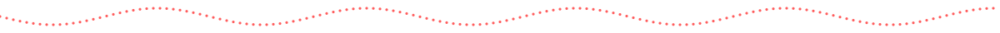

# Hey, I'm Vedant 👋

**Penn State student · hackathon regular · I build AI agents, fintech tools, and ML apps**

`ship it in 36 hours, then make it real.`

I like building things in a weekend that feel like products: agent marketplaces, fact-checkers, money apps, medical imaging.

## 🛰️ Hackathon log

| When | Project | What it does | Highlights |
|:--|:--|:--|:--|
| **Oct 2026** | 🐟 [**Fish Market**](https://github.com/vedantshirvi/fish-market-nothing-fishy) · [fishmarket.dev](https://fishmarket.dev) | A secure agentic marketplace: seller agents compete for your order in sealed rounds, every listing is scanned for scams and prompt injection, and big purchases wait for your OK on a phone call | 9 Fetch.ai agents · Cartesia voice · Stripe · SpacetimeDB · Armadin security + Hyphenate finance tracks |
| **Oct 2026** | 🤝 [**Nod**](https://github.com/vedantshirvi/Nod) | An AI product team: 5 agents turn customer interviews into ranked, security-scanned features, with the founder approving key calls | Multi-agent (Claude Code + Codex) · Cognee memory · Snyk |
| **Oct 2026** | 🏙️ [**Common Ground**](https://github.com/vedantshirvi/Common-Ground) | Finds the San Francisco neighbourhoods that fit everyone's commute and priorities before you look at listings | 41 neighbourhoods · transit GTFS · open city data |
| **Apr 2026** | 💳 [**kerdos**](https://github.com/vedantshirvi/kerdos) · [live](https://kerdos-three.vercel.app) | An AI credit-card brain: picks the best card per swipe, auto-invests cashback, and tracks it all in one dashboard | **Bitcamp 2026** (UMD) · built in 36 hrs · Plaid · Next.js |
| **Mar 2026** | 🔍 [**FadeThat**](https://github.com/vedantshirvi/FadeThat) · [live](https://fadethat.vercel.app) | Paste any article and every claim is ranked by how wrong it is, in under 10 seconds | LLM claim extraction · Vercel |
| **Apr 2025** | 🧭 **Pathfinder** | Penn State competition project | 🏆 **4th place** |

## 🧰 Toolbox

 

 

## 📡 Right now

- 🤖 Building multi-agent systems that are actually safe to let loose with money
- 📊 Machine learning and data analysis (Meta *Data Analysis with SQL* certified)
- 🛫 Always looking for the next hackathon. Let's team up!

✦ built at 3am, debugged at 4am ✦

